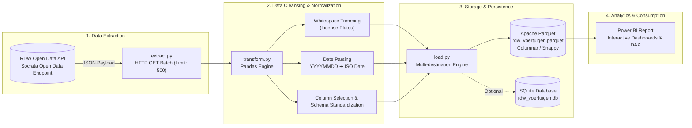
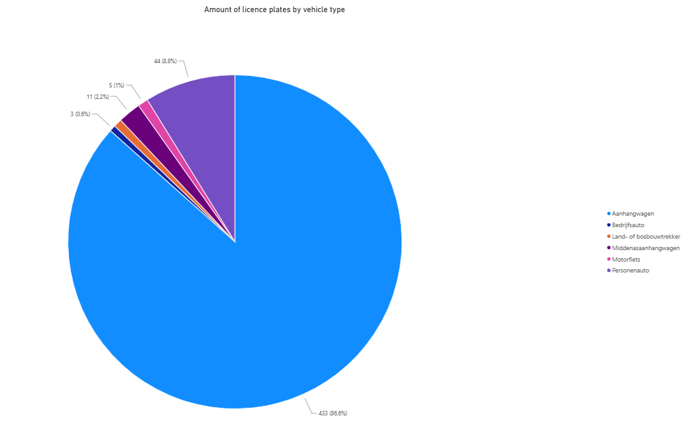

# 🚗 RDW Vehicle Fleet Data Pipeline & Analytics

An end-to-end Python ETL pipeline that extracts open vehicle registration data from the Dutch **RDW (Rijksdienst voor het Wegverkeer)** API, cleanses and formats attributes, and loads the data into high-performance analytical storage formats (**Apache Parquet** & **SQLite**) ready for business intelligence consumption via **Power BI**.

---

## 📌 Executive Summary

* **Domain:** Public Automotive & Vehicle Registration Analytics
* **Source:** Open Data RDW (Socrata Open Data API - Dataset `m9d7-ebf2`)
* **Pipeline Type:** Batch ETL (Extract, Transform, Load)
* **Storage Formats:** Columnar Apache Parquet (`.parquet`) & Relational SQLite (`.db`)
* **Analytics Layer:** Power BI Desktop (`.pbix`)
* **Core Stack:** Python 3, Pandas, PyArrow, Requests, SQLAlchemy, Power BI

---

## 🏗 System Architecture & Data Flow



---

## 📊 Power BI Dashboard Preview

> *An interactive business intelligence report built on top of the compressed Parquet data layer to track fleet composition, compliance, and registration timelines.*

<div align="center">
  
  <br/>
  <em>Figure 1: Power BI Report Overview (Fleet Distribution, Vehicle Classes & Inspection Forecasts)</em>
</div>

### 🔍 Key Metrics & Visual Insights
* **Fleet Classification:** Real-time distribution across categories (Personenauto's, Bedrijfswagens, Aanhangwagens, Motorfietsen).
* **MOT (APK) Expiration Tracking:** Proactive tracking of upcoming mandatory vehicle inspection deadlines to analyze fleet maintenance cycles.
* **Admission Cohort Trends:** Historical breakdown based on `datum_eerste_toelating` to determine average vehicle age per class.

---

## ⚙️ Key Technical Features

### 1. Robust API Ingestion (`extract/extract.py`)
* Leverages Python's `requests` library to interface with RDW's open dataset API (`https://opendata.rdw.nl/resource/m9d7-ebf2.json`).
* Implements explicit HTTP status handling via `response.raise_for_status()`.
* Supports parameterized record retrieval limits for reproducible batch ingestion.

### 2. Data Cleaning & Type Casting (`transform/transform.py`)
* **Column Scoping:** Reduces raw payload bloat by projecting strictly necessary attributes:
  * `kenteken` (License plate number)
  * `voertuigsoort` (Vehicle category: passenger car, commercial vehicle, motorcycle, trailer, etc.)
  * `vervaldatum_apk` (MOT / Technical inspection expiration date)
  * `datum_eerste_toelating` (First registration date)
* **String Sanitization:** Cleans whitespaces and irregular license plate formats using `.str.strip()`.
* **Date Normalization:** Robust parsing of custom integer-like date strings (`%Y%m%d`) into standardized Python `datetime.date` objects with `errors='coerce'` to handle missing or corrupt historical data gracefully.

### 3. High-Performance Analytical Storage (`load/load.py`)
* **Apache Parquet Storage:** Persists clean records into compressed, columnar Parquet format using PyArrow engine. This drastically reduces storage size and accelerates downstream analytics queries.
* **Relational Support:** Pre-configured SQLAlchemy connection engine ready for SQLite persistence (`rdw_voertuigen.db`) for lightweight SQL exploration.

### 4. Interactive Reporting (`PowerBI/`)
* Pre-built **Power BI** dashboard model directly reading the optimized output.
* Designed for fleet monitoring, category distribution, vehicle age breakdowns, and MOT expiration compliance tracking.

---

## 📂 Repository Structure

```text
.
├── extract/
│   └── extract.py             # API consumer (RDW Open Data REST API)
├── transform/
│   └── transform.py           # Pandas transformation & cleaning pipeline
├── load/
│   └── load.py                # Dual destination loader (Parquet & SQLite)
├── PowerBI/
│   ├── Basic PowerBI report from parquet.pbix   # Power BI report & data model
│   └── dashboard_screenshot.png                 # Dashboard preview screenshot
├── rdw_voertuigen.parquet     # Generated columnar dataset
├── rdw_voertuigen.db          # Generated SQLite database file (optional)
├── main.py                    # Orchestration script (executes end-to-end pipeline)
├── requirements.txt           # Project dependencies & versions
└── README.md                  # Project documentation
```

---

## 🚀 Getting Started

### Prerequisites
* Python 3.10+ installed
* Power BI Desktop (optional, for viewing `.pbix` reports)

### 1. Installation
Clone the repository and install the dependencies:

```bash
git clone https://github.com/your-username/rdw-vehicle-etl.git
cd rdw-vehicle-etl

python -m venv venv
# On Windows:
venv\Scripts\activate
# On Linux/macOS:
source venv/bin/activate

pip install -r requirements.txt
```

### 2. Running the ETL Pipeline
Run the main pipeline controller:

```bash
python main.py
```

Console output:
```text
Extracting data...
Data is transforming...
Loading data into database...
Succesvol 500 rijen weggeschreven naar tabel 'voertuigen' in rdw_voertuigen.db
```

### 3. Exploring the Data
* **Parquet File:** Load `rdw_voertuigen.parquet` directly into **Power BI**, Pandas, DuckDB, or Polars.
* **Power BI:** Open `PowerBI/Basic PowerBI report from parquet.pbix` to interact with the visualizations and metrics.

---

## 📈 Data Schema & Output Definition

| Field Name | Type | Description |
| :--- | :--- | :--- |
| `kenteken` | `String` | Vehicle license plate (cleaned and stripped) |
| `voertuigsoort` | `String` | Registered vehicle classification (e.g., Personenauto, Motorfiets) |
| `vervaldatum_apk` | `Date` | Expiration date of statutory vehicle inspection (APK) |
| `datum_eerste_toelating` | `Date` | Official date when the vehicle was first registered / admitted |

---

## 💡 Roadmap & Future Enhancements

* [ ] Implement pagination (using `$offset`) to ingest larger historical batches.
* [ ] Add automated unit tests with `pytest` for transformation edge-cases.
* [ ] Integrate CI/CD with GitHub Actions to trigger scheduled weekly data refreshes.
* [ ] Containerize the ETL execution using Docker.